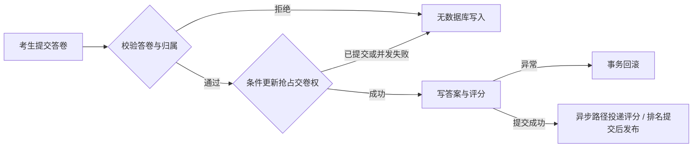

# 在线考试可信交卷与成绩一致性

考生在交卷时可能重复点击、断网后重试，甚至两个请求同时到达。一次考试只能产生一份可信成绩：他人不能代交，答案与成绩要一起成功或一起失败，数据库确认提交后才能安排评分和更新排名。

本地启动后打开 [中文交卷演示页面](http://127.0.0.1:18080/sg-user-service/submission-demo)，按页面五步操作，或一键运行完整演示。页面使用合成账户和真实接口，显示每次请求的结果，并核对数据库成绩与 Redis 排名。

[](docs/DEMO.md)

[阅读完整场景、设计与演示](docs/DEMO.md) · [本机运行基线](BASELINE.md) · [上游来源](UPSTREAM.md)

## 系统结构与改进范围

| 环节 | 作用 | 本仓库的改进 |
| --- | --- | --- |
| 交卷入口 | 接收考生答卷与答案 | 逐条校验归属、租户和题目，拒绝代交与伪造答案 ID |
| MyBatis + 数据库 | 决定谁获得交卷权 | 带状态条件的更新、事务评分和失败回滚 |
| 异步评分 | 处理单题交卷后的评分 | 提交后投递、任务抢占与过期待评分恢复 |
| Redis 排名 | 提供成绩排行 | 数据库提交成功后发布，数据库成绩仍是事实来源 |
| 演示与测试 | 重放可解释的故障场景 | 合成双账户五步演示、H2 与隔离 MySQL 测试 |

这条主线把“用户重试或并发交卷”转化为可执行的边界条件：一个答卷至多成功交卷一次，拒绝他人代交，且最终成绩与排名可以核对。页面演示覆盖同步批量交卷；异步恢复由独立测试验证，验收范围在下文说明。

## 解决的问题

原有批量交卷直接按请求中的答卷编号写入答案并评分，缺少答卷归属与状态条件；异步评分在事务提交前就可能启动，Redis 排名也可能先于数据库提交。这会使重复请求、多用户误操作或评分失败后的结果难以解释。

本仓库围绕**交卷一致性**增加了以下约束：

1. 校验每道答案来自同一答卷，拒绝重复题目；已有答案的数据库 ID 由服务端确定，不信任客户端传来的 ID。
2. 用一条带 `答卷 ID + 考生 ID + 租户 + 未提交状态` 条件的 SQL 抢占交卷权。数据库行锁保证并发请求只有一个成功；匿名问卷按答卷、考试和租户独立校验。
3. 批量答案与评分位于同一事务，失败则连交卷状态一起回滚。异步评分只在提交事务成功后入队，评分任务自身使用独立事务。
4. Redis 排名在数据库事务提交后更新，回滚不会发布未成立的成绩。
5. 异步答卷保留“待评分”状态；进程中断或线程池投递失败后，定时任务只预约超过五分钟的记录。评分线程在独立事务内抢占记录并计算，失败回滚后可再次预约。

扫描 SQL 使用 `(submit_status, is_deleted, update_time, id)` 联合索引：前两列等值筛选，后两列对应过期范围与排序。全新演示库由初始化脚本创建索引；已有 MySQL 库需先执行 [一次性迁移](config-repo/mysql/migrations/20261025_submission_recovery_index.sql)。尚未做大数据量 `EXPLAIN` 对照或吞吐量压测。



## 本机验证

在 Windows PowerShell、Java 17 环境中，进入仓库根目录：

```powershell
.\scripts\local.ps1 -Action Test
.\scripts\local.ps1 -Action Build
.\scripts\local.ps1 -Action Start
.\scripts\check-local.ps1
```

启动后打开 [中文交卷演示](http://127.0.0.1:18080/sg-user-service/submission-demo)。页面输入合成账户 `preview` 和 `admin` 的样本密码（初始化样本为 `123456`），点击“运行完整演示”，也可逐步点击查看越权、重复提交及最终成绩。输入只保留在浏览器内存，页面不会把密码写入仓库。接口明细可在 [Swagger UI](http://127.0.0.1:18080/sg-user-service/swagger-ui/index.html) 查看。停止本脚本启动的本地服务：`.\scripts\local.ps1 -Action Stop`。

现场演示只需保持 18080 运行，另开 PowerShell 执行 `.\scripts\demo-api.ps1`。按提示输入上游**合成样本**账户 `preview` 和 `admin` 的演示密码（初始化样本为 `123456`）；脚本逐项核验越权拒绝、正常交卷、重复拒绝、成绩与排名。结束后窗口会等待按回车，结果同时保存在忽略目录 `.run/demo-result.json`，即使关窗也能查看；失败时该文件记录原因。密码隐藏输入，不写入结果文件或仓库。多次演示会创建新的合成答卷。

截至 2026-10-25，选定的 **17 项测试通过**：条件更新、真实事务回滚、双线程争抢和过期任务预约等 6 项 Mapper 测试又在隔离的 MySQL 8.0 测试库上跑过；其余为 H2/单元测试。中文页面在真实浏览器中完成五步交卷并检查手机宽度；本机 OpenAPI、公开查询、未登录拦截和 Redis PING 也通过。另用合成账户在 MySQL + Redis 上走通同一组 HTTP 交卷动作；复现步骤与结果见 [演示与设计](docs/DEMO.md)。

本机快速启动用 H2，不会自动变成 MySQL。MySQL 验收需要单独的隔离数据库，测试入口只接受本机 `127.0.0.1:13306` 上名为 `sg_exam_test_*` 的库：

```powershell
$env:SG_TEST_MYSQL_URL = 'jdbc:mysql://127.0.0.1:13306/sg_exam_test_demo?useSSL=false&allowPublicKeyRetrieval=true&serverTimezone=UTC'
$env:SG_TEST_MYSQL_USER = '<your-local-user>'
$env:SG_TEST_MYSQL_PASSWORD = '<your-local-password>'
.\scripts\local.ps1 -Action Test
Remove-Item Env:SG_TEST_MYSQL_URL,Env:SG_TEST_MYSQL_USER,Env:SG_TEST_MYSQL_PASSWORD
```

这组测试会在该**专用测试库**中重建自己的 `exam_examination_record` 表，不要指向已有业务库。上面的 `demo-api.ps1` 默认使用 H2 本机预览；若要对另行启动的 MySQL 演示应用重放同一流程，可传 `-BaseUrl 'http://127.0.0.1:18081/sg-user-service'`。两种运行配置的验证证据分别说明，不把 H2 当 MySQL。

## 代码入口

| 关注点 | 位置 |
| --- | --- |
| HTTP 交卷入口 | `sg-exam-service/src/main/java/com/github/tangyi/exam/controller/AnswerController.java` |
| 交卷校验与评分 | `sg-exam-service/src/main/java/com/github/tangyi/exam/service/exam/ExaminationActionService.java` |
| 条件更新 SQL | `sg-exam-service/src/main/resources/mappers/exam/ExamRecodeMapper.xml` |
| 排名提交后更新 | `sg-exam-service/src/main/java/com/github/tangyi/exam/service/RankInfoService.java` |
| 过期异步任务恢复 | `sg-exam-service/src/main/java/com/github/tangyi/exam/service/exam/SubmissionRecoveryService.java` |
| 中文演示页面 | `sg-user-service/src/main/resources/portfolio/submission-demo.html` |
| 合成场景测试 | `sg-user-service/src/test/java/com/github/tangyi/baseline/` |

异步恢复依赖本地定时扫描，不是持久化队列；进程崩溃后会有最多一个扫描周期加五分钟的等待，且没有做双实例部署验收。Redis 发布失败尚无自动重建；匿名问卷未实现一次性身份令牌。详见演示页的边界说明。

本项目基于 [sg-exam](https://github.com/wells2333/sg-exam) 改进，保留上游 Git 历史及 Apache-2.0 许可证。考试平台、Spring Boot/Vue 模块与原有题库等属于上游；上述交卷一致性改动和验证为本仓库增量。[上游原 README](docs/UPSTREAM_README.md)。
