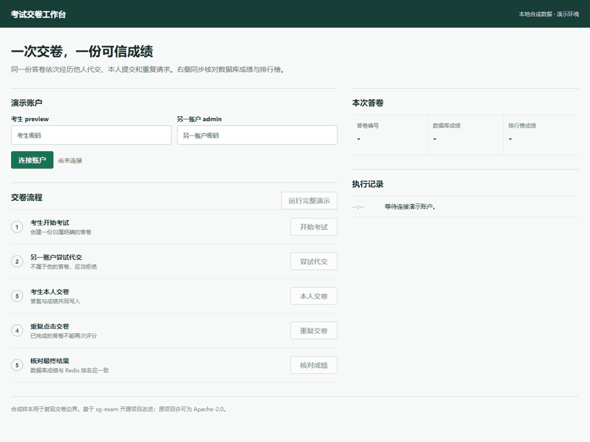
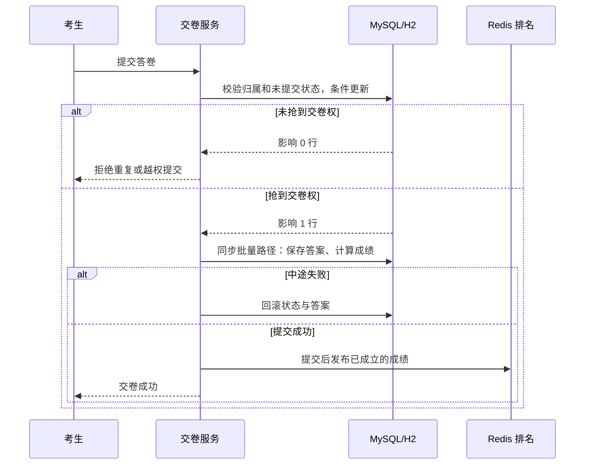
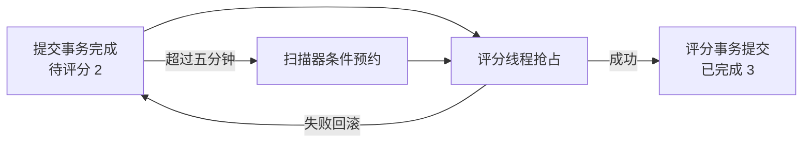

# 交卷一致性：场景、设计与演示

**解决的问题：** 重试、并发和代交会让同一份答卷出现重复评分或不可信成绩。我们把交卷权交给数据库条件更新，在事务内保存答案与成绩，并让异步任务和 Redis 发布遵守提交边界；最后用双账户操作、并发与回滚测试核对结果。

启动本机服务后，可在 [中文交卷工作台](http://127.0.0.1:18080/sg-user-service/submission-demo) 逐步操作或一键演示。页面通过真实登录、开考、提交和查询接口显示结果；样本账户与题目均为合成数据。

动图来自本机浏览器逐步点击，展示业务结果，不用于衡量请求延迟。

## 用户场景

小林完成线上考试，点击交卷时页面反应慢，于是再次点击。两个请求先后或同时到达服务端。如果都能修改答卷，就可能重复评分、覆盖答案、产生不同步的成绩与排名。管理员希望能解释每次交卷为什么成功或失败，并让答卷最终只有一份成绩。

## 发现与定位

审查原有 `submitAll`、`submitAsync` 和排名写入时，定位到四个具体风险：

| 输入或故障 | 原有风险 | 这次的处理 |
| --- | --- | --- |
| 两个请求提交同一答卷 | 按 ID 更新，没有未提交状态门槛 | SQL 条件更新只让一位请求者成功 |
| 请求携带别人的答卷/答案 ID | 仅用第一个答卷 ID 查询，更新时可沿用客户端答案 ID | 校验整批答卷，普通交卷校验考生及租户，服务端选择已存在答案 ID |
| 评分中途抛错 | 状态、答案、成绩可能不同步 | 同一事务内写入；异常回滚 |
| 数据库还没提交就启动异步评分/写排名 | 任务读不到新状态，或 Redis 有未成立的成绩 | `afterCommit` 后投递与发布；评分任务单独开事务 |
| 提交已提交到数据库，进程却在投递评分前退出 | 答卷长期停在“待评分” | 定时扫描过期记录；条件更新预约；评分事务抢占并回滚失败任务 |

## 模块分工与操作证据

| 用户或系统动作 | 关键实现 | 可见或可验证的结果 |
| --- | --- | --- |
| 他人尝试代交 | [交卷校验](../sg-exam-service/src/main/java/com/github/tangyi/exam/service/exam/ExaminationActionService.java) | 页面和 API 均拒绝，答卷仍属原考生 |
| 本人提交后立即重试 | [状态条件 SQL](../sg-exam-service/src/main/resources/mappers/exam/ExamRecodeMapper.xml) | 首次成功，重复请求更新 0 行；并发测试仅一人成功 |
| 写入中途失败 | [交卷事务](../sg-exam-service/src/main/java/com/github/tangyi/exam/service/exam/ExaminationActionService.java) | 状态与答案一起回滚，不产生排名副作用 |
| 异步评分中断 | [恢复扫描](../sg-exam-service/src/main/java/com/github/tangyi/exam/service/exam/SubmissionRecoveryService.java) | 只预约过期待评分记录，任务再次抢占；此项由测试验证 |
| 查看最终结果 | [排名发布](../sg-exam-service/src/main/java/com/github/tangyi/exam/service/RankInfoService.java) | 页面与 API 对照数据库成绩和 Redis 排名 |

演示页面属于本仓库新增的合成场景入口；考试平台、题库与 Spring 模块来自上游，交卷一致性改动、验证脚本及测试是本仓库增量。具体来源见文末许可说明。

上图是页面使用的同步批量交卷。单题交卷走下方的异步状态流：先提交待评分状态，再投递评分任务，最终评分事务提交后才发布排名。两条路径不会同时投递和评分。

## 异步中断后的恢复

异步交卷先在数据库把答卷置为 `2 待评分`，提交事务成功后才投递到原有评分线程池。评分线程在**同一个新事务**中将状态抢占为 `4 评分处理中`、计算答案、写入最终状态 `3`；若计算抛错，整个评分事务回滚，状态重新是 `2`。本地演示开启的扫描器每五分钟查找停留超过五分钟的记录，用“仍是待评分且更新时间足够旧”的条件更新预约，再投递评分。第二个扫描器或旧线程抢不到同一记录；即使任务先后入队，评分 SQL 也只让一个线程继续。

评分读取答卷时绕开 Redis 记录缓存，直接读取同一数据库事务中的最新行，避免把尚未提交的“处理中”状态作为缓存快照写出去。最终成绩仍由数据库保存，排名只在事务提交后更新。

扫描器默认关闭，只在本机启动脚本显式开启。扫描间隔和过期阈值均为五分钟；因此它保障的是**最终重试**，不是即时恢复，也不是跨服务的持久化消息队列。真实停进程/重启的完整 HTTP 故障注入尚未做；已在 H2 与隔离 MySQL 验证状态抢占、回滚、过期预约及并发只赢一次，并单测调度器只重排预约成功的记录。

扫描查询按 `submit_status=2`、`is_deleted=0`、`update_time<截止时间` 筛选，再按更新时间和主键排序取前 100 条。联合索引按这一路径设计；新库在初始化脚本中创建，旧 MySQL 库有[一次性迁移](../config-repo/mysql/migrations/20261025_submission_recovery_index.sql)。目前没有记录大数据量 `EXPLAIN` 或查询耗时对照，因此不宣称具体加速倍数。

## 可复现的本机演示

1. 运行 `.\scripts\local.ps1 -Action Test`。`SubmissionClaimTests` 直接加载生产 MyBatis Mapper 的 SQL，在合成 H2 表上验证考生/租户/考试条件、重复提交、真实回滚、双线程争抢与过期任务预约；配置 README 中的隔离 MySQL 测试库后，同样 6 项 Mapper 测试会在真实 MySQL 上运行。`SubmissionValidationTests` 验证混合答卷、重复题目、伪造答案 ID 及未抢占时不写答案。
2. `SubmissionSideEffectTests` 在 Spring 事务中模拟回滚和提交。回滚不调用 Redis、不投递异步任务；提交后才分别发生。
3. 运行 `.\scripts\local.ps1 -Action Build` 和 `-Action Start`，用 `check-local.ps1` 验证中文页面、OpenAPI、数据库查询、未登录拦截与 Redis PING。打开 [本机中文工作台](http://127.0.0.1:18080/sg-user-service/submission-demo)，输入两个样本账户密码，逐步点击或使用“运行完整演示”。[Swagger UI](http://127.0.0.1:18080/sg-user-service/swagger-ui/index.html) 仍可查看 `答题信息管理` 接口。
4. 保持 18080 运行，执行 `.\scripts\demo-api.ps1`，按隐藏提示输入合成账户 `preview`、`admin` 的样本密码 `123456`。结果会保存到 `.run/demo-result.json`，关窗后仍可查看；窗口默认停在“按回车关闭”。这条 H2 本机路径可现场复现整套操作；2026-10-25 实跑返回答卷 `1`，代交拒绝、本人成功、重试拒绝、成绩和排名均为 `5`。

2026-10-25 实测：17 项选定测试在默认配置和隔离 MySQL 配置各通过一次；应用构建成功；中文页面在真实浏览器完成五步流程，数据库与 Redis 都返回 5 分，390px 手机视口无横向溢出。MySQL 测试使用隔离数据库和生产 Mapper XML；它不构成全系统性能或隔离级别验收。

### 完整 API 演示：一次交卷只有一个赢家

另在本机启动 MySQL 8.0 隔离演示库、导入上游 `config-repo/mysql/init.sql` 中的合成题目和账户，运行应用、Redis 后执行 `scripts/demo-api.ps1 -BaseUrl 'http://127.0.0.1:18081/sg-user-service'`。脚本通过隐藏输入读取本机演示账户口令，依次执行：

| 操作 | 2026-10-25 实际结果 |
| --- | --- |
| 学员登录后在开考请求中伪造 `userId=1` | 服务端仍按令牌创建 `userId=2` 的答卷 |
| 另一个账户先提交该答卷 | 返回 `false`，无代交 |
| 学员提交时伪造已有答案 `id=999999` | 返回 `true`，服务端使用数据库中的答案 ID |
| 同一学员再次提交 | 返回 `false`，不能重复评分 |
| 查询答卷及 Redis 排名 | 答卷状态 `3`、分数 `5`；排名分数 `5` |

本次脚本输出的合成答卷编号为 `3`。这是**真实 MySQL + Redis + HTTP** 的单机验收，不是浏览器操作录屏；快速 H2 Swagger 页面与它是两种不同运行配置。样例题目和分数不代表真实用户数据。

## 设计取舍与待验收项

- 条件更新放在数据库，而不是 Redis 锁：同一行的状态与交卷权在一个事务内决定，服务重启或锁过期不会制造第二个赢家。
- Redis 只保存可再生的排名，不作为成绩真相。发布失败目前记录日志，尚无自动重建任务。
- 定时扫描会重新投递过期的“待评分”答卷；尚未做真实进程崩溃/重启故障注入，也未测试多实例部署。浏览器演示走同步批量交卷，恢复机制的证据来自 Mapper 与调度器测试。
- 匿名端点保留上游问卷流程，并按考试及租户条件更新；当前没有一次性答卷令牌，不应声称具备与登录用户同等级的身份隔离。
- 中文工作台已在真实浏览器完成一次端到端点击；`demo-api.ps1` 可重复核对 HTTP 结果。浏览器演示使用本机 H2，另有 MySQL + Redis 的 API 脚本验收；不能把前者写成 MySQL 浏览器验收。
- 上游通用的答卷查询、单题作答等接口未做完整逐接口权限审计；本轮保障的是上述开考与批量/异步交卷入口，不能据此宣称整站权限已经完善。

上游来源、许可与改进范围见 [UPSTREAM.md](../UPSTREAM.md)。
